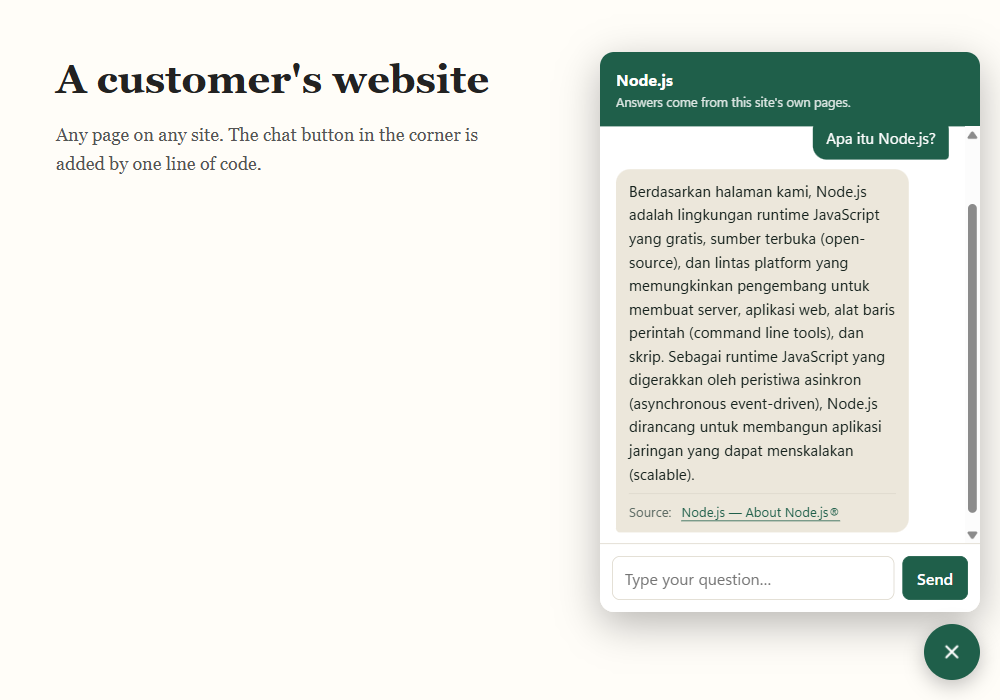
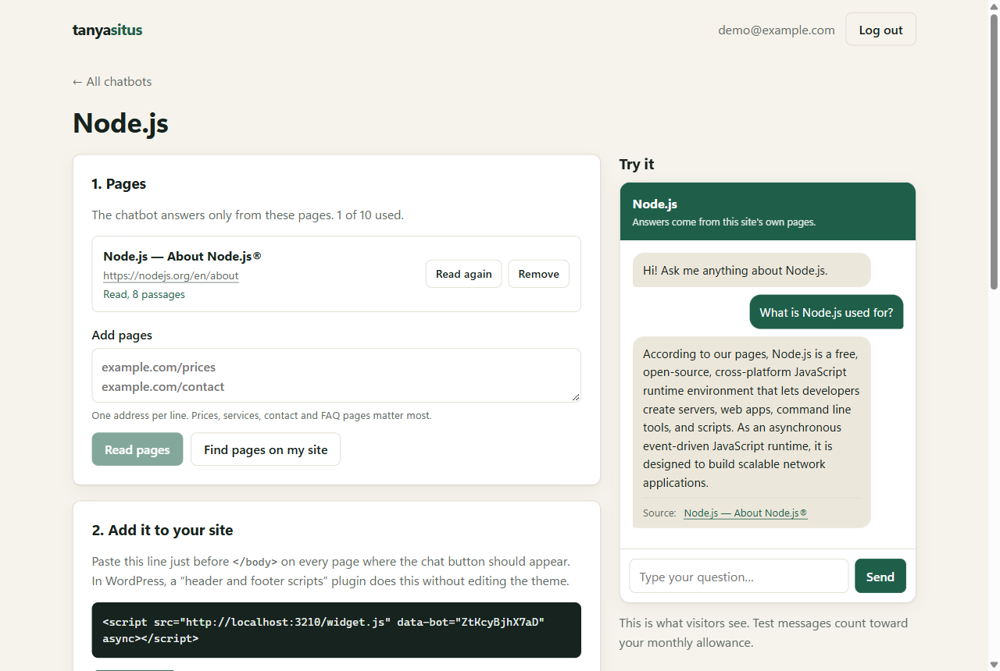

# Tanya Situs

A chatbot service for small-business websites. An owner signs up, gives it the pages of their site, and pastes one line of code. Visitors then get answers taken from those pages, with a link to the source. When the pages do not cover a question, the bot says so and asks for the visitor's contact details instead of guessing.

"Tanya situs" is Indonesian for "ask the site".





## What an owner gets

- **A chatbot built from their own pages.** They type the site address, pick pages from a list found on the home page, and each page is read in a few seconds.
- **One line of code to install.** A `<script>` tag adds a chat button to any site: WordPress, Shopify, Wix or plain HTML.
- **Leads.** When a visitor wants to order or book, or the bot cannot answer, it asks for a name and an email or phone number.
- **A list of questions the site could not answer**, which is a to-do list for the site's content.
- **Answers in the visitor's language**, even when the pages are written in another one.

## How it works

```
Owner adds a page address
  -> address is checked (public web only, see Security)
  -> robots.txt is read; a disallowed page is not fetched
  -> page is fetched, at most 2 MB, HTML only
  -> menus, footers, forms and scripts are removed
  -> text is split into one passage per heading
  -> passages are stored in Postgres

Visitor asks a question
  1. Quota       the message is counted against the owner's monthly allowance
  2. Planner     (LLM) detects language and intent, rewrites the message into a search
                 query in the language of the pages
  3. Retrieval   BM25 keyword search over that bot's passages, top 8
  4. Answer      (LLM) answers from those passages only, returns {status, answer, source_ids}
  5. Checks      in code, see below
```

### Checks that do not depend on the prompt

A prompt is an instruction, not a guarantee, so these run in code after the model has answered (`src/lib/chat/answer.ts`, `src/lib/chat/guardrails.ts`):

| Check                | What happens                                                                                                                  |
| -------------------- | ----------------------------------------------------------------------------------------------------------------------------- |
| Sources are real     | A cited passage only counts if it was retrieved for this question. Links are built from stored addresses, never model output. |
| Prices are real      | Every money amount in the answer must appear in a retrieved passage. If one does not, the whole answer is replaced.           |
| No source, no answer | An answer marked "answered" without a valid source is treated as not found.                                                   |
| Fixed fallback text  | "I couldn't find that" and error messages are fixed strings, so they cannot contain an invented fact.                         |
| Gaps are recorded    | Every question that ends as "not found" is saved for the owner, with the reason.                                              |

Each reply has one of five statuses:

| Status      | When                                              | What the visitor sees                           |
| ----------- | ------------------------------------------------- | ----------------------------------------------- |
| `answered`  | The pages answer the question                     | Answer and source link(s)                       |
| `not_found` | The pages do not cover it, or a check rejected it | "Not on our pages", contact link, lead form     |
| `contact`   | The visitor wants to order, book or reach someone | "I can't do that here", contact link, lead form |
| `declined`  | Unrelated to the business                         | Polite decline                                  |
| `smalltalk` | Greetings and thanks                              | Short reply                                     |

## Technology, and why

| Choice                                                | Why                                                                                                                                                                                                    |
| ----------------------------------------------------- | ------------------------------------------------------------------------------------------------------------------------------------------------------------------------------------------------------ |
| **Next.js 16 + TypeScript**                           | Dashboard, public chat page and API in one project. Dashboard forms are server actions.                                                                                                                |
| **Postgres**                                          | Accounts, bots, pages, passages, leads and usage. In production it is any Postgres server (`DATABASE_URL`).                                                                                            |
| **PGlite for development and tests**                  | Postgres compiled to WebAssembly, running in-process. `npm run dev` needs no database to be installed, and the tests run the same SQL against the same engine as production instead of against a mock. |
| **BM25 keyword search** (`src/lib/retrieval/bm25.ts`) | A bot has a few hundred passages. At that size keyword search is fast, costs nothing per query, and a hit can be explained by the words it matched. No vector database or embedding service.           |
| **Gemini `gemini-3.5-flash-lite`**                    | Cheap and fast enough for two calls per message. The client (`src/lib/llm.ts`) speaks the OpenAI-compatible API, so another provider is two environment variables away.                                |
| **Own login, standard library only**                  | scrypt password hashes and random session tokens stored as SHA-256 hashes. Small enough to read in one sitting (`src/lib/auth/`).                                                                      |
| **Widget in an iframe** (`public/widget.js`)          | The host page's CSS cannot break the chat, and the chat cannot read the host page.                                                                                                                     |
| **Vitest**                                            | 115 tests. The LLM and the network are replaced by fakes; the database is real.                                                                                                                        |

## Security

The service fetches addresses typed by customers and shows model output on other people's websites, so these matter:

- **The crawler cannot be pointed at private networks.** Addresses are limited to `http`/`https` on standard ports. Loopback, private, link-local (including cloud metadata) and other non-public ranges are refused for IPv4 and IPv6. The check is done in the DNS resolver that the HTTP client connects with, so a hostname cannot pass the check with one address and connect to another. Redirects are followed by hand and every hop is checked again. See `src/lib/crawl/safe-url.ts` and `src/lib/crawl/fetch.ts`.
- **Customers are isolated in the query, not in the caller.** Every function that reads or changes an owner's data takes the account id and puts it in the `WHERE` clause (`src/lib/store.ts`). A test signs in as a second customer and tries to read, change and delete the first one's bot.
- **Passwords** are hashed with scrypt and a per-password salt. Login answers "wrong email or password" for both cases and takes the same time for an unknown email.
- **Sessions** are random 256-bit tokens in an `HttpOnly`, `SameSite=Lax` cookie; the database stores only their hash.
- **Page text is data.** The prompt tells the model to ignore instructions inside the pages, and the business name is stripped of line breaks and quotes before it enters a prompt. Model output is rendered as text, never as HTML.
- **Links cannot run script.** The owner's contact link must be `https`, `http`, `mailto` or `tel`.
- **Only the chat page can be framed.** Every other page sends `frame-ancestors 'self'`.
- **Limits protect the LLM budget**: a monthly message allowance per account, a per-visitor rate limit, 500 characters per question, and page and chatbot limits per plan.

## Run it

Requires Node.js 20 or newer.

```bash
npm install
cp .env.example .env.local      # then put your key in LLM_API_KEY
npm run dev                     # http://localhost:3000
```

A free Gemini key is available at https://aistudio.google.com/apikey. No database setup is needed: without `DATABASE_URL` an embedded Postgres is created in `.data/`.

| Command                          | What it does                                |
| -------------------------------- | ------------------------------------------- |
| `npm run dev`                    | Start the app locally                       |
| `npm test`                       | All tests, no network or API key needed     |
| `npm run typecheck`              | TypeScript check                            |
| `npm run format`                 | Format with Prettier                        |
| `npm run build`                  | Production build                            |
| `npm run plan -- <email> <plan>` | Move an account to the `free` or `pro` plan |

### Environment variables

| Name                 | Required      | Purpose                                                                       |
| -------------------- | ------------- | ----------------------------------------------------------------------------- |
| `LLM_API_KEY`        | yes           | API key for the LLM provider                                                  |
| `LLM_BASE_URL`       | no            | OpenAI-compatible endpoint. Default: Gemini                                   |
| `LLM_MODEL`          | no            | Default: `gemini-3.5-flash-lite`                                              |
| `LLM_FALLBACK_MODEL` | no            | Second model on the same endpoint, used when the first stays busy             |
| `DATABASE_URL`       | in production | Postgres connection string. The schema in `db/schema.sql` is applied on start |
| `DATABASE_CA`        | no            | Root certificate of the database provider, to verify its identity             |
| `APP_URL`            | no            | Public address of the app, used in the embed code shown to owners             |
| `SIGNUPS_OPEN`       | no            | Set to `false` to stop new accounts                                           |
| `CONTACT_URL`        | no            | Where the "Upgrade" and "Ask for Pro" links point. Read at build time         |

## Deploying

The app needs a Postgres database and a Node.js host. This is the setup it was written for:

**Supabase (database).** Supabase serves every table in the `public` schema through its own REST API, which this app does not use. To keep the tables out of it, they live in a separate schema that the API roles cannot reach, owned by a role that can do nothing else:

```sql
CREATE SCHEMA tanya;
CREATE ROLE tanya_app LOGIN PASSWORD 'a-long-random-password';
GRANT USAGE, CREATE ON SCHEMA tanya TO tanya_app;
ALTER ROLE tanya_app SET search_path = tanya;
REVOKE ALL ON SCHEMA tanya FROM PUBLIC;
```

`DATABASE_URL` then points at the connection pooler in transaction mode, which is what a serverless host should use:

```
postgresql://tanya_app.<project-ref>:<password>@aws-0-<region>.pooler.supabase.com:6543/postgres?sslmode=no-verify
```

`sslmode=no-verify` encrypts the connection without checking the server's certificate, because Supabase signs it with its own root certificate. To have it checked, download that certificate from the project's database settings, put it in `DATABASE_CA`, and remove `sslmode` from the URL.

**Vercel (hosting).** Import the repository, add `LLM_API_KEY` and `DATABASE_URL`, deploy. The tables are created on the first request.

## Plans

Plans are limits in `src/lib/limits.ts`:

| Plan | Chatbots | Pages per chatbot | Messages per month |
| ---- | -------- | ----------------- | ------------------ |
| Free | 1        | 10                | 200                |
| Pro  | 5        | 50                | 5,000              |

There is no payment integration. An account is moved to Pro by hand with `npm run plan`, after the customer has paid by whatever means was agreed.

## Limitations

- **Not deployed yet, and not measured yet.** It has been run locally against real pages and a real model, but there is no hosted demo and no evaluation set like the one in my PlacidWay chatbot. Answer quality on Indonesian small-business sites is untested.
- **No email verification and no password reset.** An owner who forgets their password needs it reset in the database. Both need an email provider.
- **No payments.** See Plans.
- **Pages that build their content with JavaScript cannot be read.** The page is fetched as served; no browser is run. Such a page is reported to the owner with that explanation.
- **Keyword search only.** A question that uses none of the words on the page ("how much" against a page that only says "tarif") depends on the planner rewriting it well. Embeddings would help once a bot has many pages.
- **The price check compares numbers only.** It cannot tell that a correct price was attached to the wrong product, and it rejects a correct price the model reworded ("1,5 juta" for "Rp 1.500.000").
- **Rate limits are kept in memory**, per server instance. On serverless hosting they are a speed bump; the monthly allowance in the database is the real limit.
- **Pages are read when the owner asks.** There is no scheduled refresh, so a changed price stays stale until "Read again" is pressed.
- **Conversations are not stored.** Only leads and unanswered questions are kept.
- **The dashboard is in English.** The chat window follows the site's language (English or Indonesian).

## Project structure

```
db/schema.sql               tables, applied on start
public/widget.js            the script customers paste into their site
src/
  app/
    page.tsx                landing page
    login/, signup/         account pages
    dashboard/              owner's pages
    embed/[botId]/          the chat window shown inside the widget
    api/chat, api/lead      public endpoints used by the chat window
    actions.ts              server actions for everything an owner does
  components/               Chat, PagesManager, SettingsForm, ...
  lib/
    auth/                   password hashing, sessions
    crawl/                  safe-url, fetch, robots, extract, chunk
    retrieval/bm25.ts       tokenizer and index
    chat/                   answer pipeline, prompts, guardrails
    db/client.ts            Postgres or PGlite behind one interface
    store.ts                every SQL statement
    ingest.ts               read one page and store the outcome
    limits.ts               plans
scripts/set-plan.ts         change an account's plan
tests/                      Vitest
```

## License

[MIT](LICENSE)
